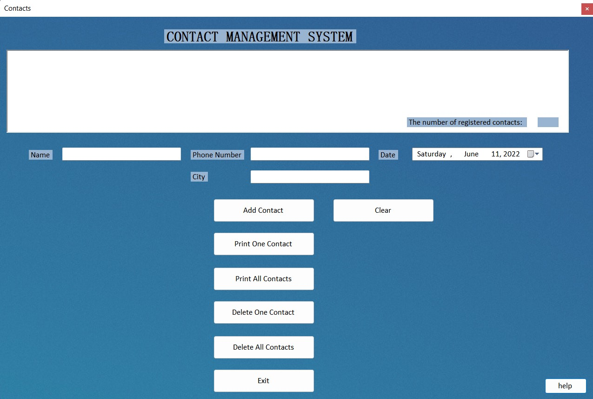

# Contact Management

An earlier C# Windows Forms learning project for managing contacts in memory.

[Original video demonstration](https://user-images.githubusercontent.com/68010191/173190819-d4debdfa-5fe9-4df0-945e-9cc301c25257.mp4)

## Features

- Add a contact with a name, phone number, birthday, and city.
- Find a contact by name using case-insensitive matching.
- Display all contacts.
- Delete one contact or clear the list.
- Validate required name, phone, and city fields.

## Run locally

This is a Windows desktop application. Open `ContactManagement.sln` in Visual Studio with the .NET desktop development workload and support for the project's `net6.0-windows` target, then build and run.

The repository targets .NET 6; upgrading the target framework is a future maintenance task.

## Code map

- `ContactManagement/Form1.cs` — form event handlers and contact operations.
- `ContactManagement/Form1.Designer.cs` — generated form layout.
- `ContactManagement/Contact.cs` — contact model.
- `ContactManagement/ContactManagement.csproj` — application configuration.

## Current limitations

Contacts are stored in memory and are lost when the application closes. The implementation initially allocates 100 array entries and does not safely handle capacity growth; the About dialog's claim of 500 contacts does not match the code. This project is a learning example, not a production contact database.

## Next improvements

- [ ] Replace fixed-size array management with a collection and add regression tests.
- [ ] Save contacts to a local data store.
- [ ] Validate phone numbers and handle duplicate names.
- [ ] Remove tracked IDE caches and generated build files, and add ignore rules.
- [ ] Upgrade the framework target and verify a clean Windows build.
